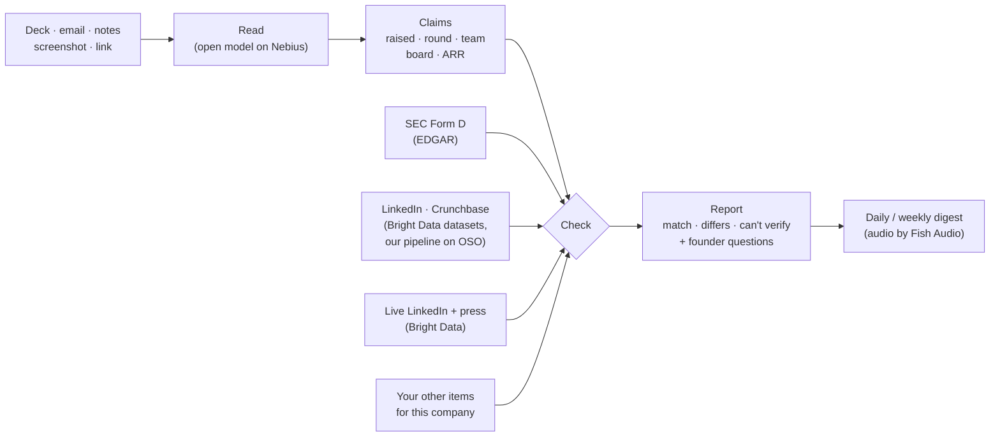

# VentureSauce

## Team 11 — Andi · Surya · Javier · Kevin

**Fact-check every founder claim before the partner meeting.** Powered by real public data from [Bright Data](https://brightdata.com) and SEC EDGAR.

Drop in a deck, an email, call notes or a screenshot. VentureSauce files it under the company, checks every claim against public records and against everything else the founder sent you, then hands you the questions to ask.


## Why

- Numbers drift. Quartermaster AI's raise was reported as $43M; its SEC filing shows $122.65M sold. Legora announced 400 people; LinkedIn shows 919.
- Checking by hand means tabs, filings and spreadsheets for every deal.
- VentureSauce does it in the side panel, and **every number links to its source**.

## Powered by Bright Data

A Form D only says *who filed and how much*. Bright Data tells us everything else: team size, funding history, who wrote about the round.

| Bright Data product | What it gives us | Where |
| --- | --- | --- |
| **Web Unlocker** | Live funding headlines (Google News) and LinkedIn company pages, on every lookup | [`backend/sources/minimal_live.py`](backend/sources/minimal_live.py) |
| **SERP API** | Funding news plus LinkedIn and Crunchbase URLs for 1,000 startups | [`pipeline/`](pipeline/) |
| **LinkedIn dataset + Scraper API** | Headcount, followers, HQ, last round | [`pipeline/`](pipeline/) |
| **Crunchbase dataset + Scraper API** | Funding rounds, totals, investors | [`pipeline/`](pipeline/) |

**Coverage today:** 1,000 startups built from Form D filings (425 with LinkedIn, 441 with Crunchbase), plus 30 companies tied to this hackathon's judges and mentors. All of it sits in OSO and is read by [`backend/sources/oso.py`](backend/sources/oso.py).

**One real check, end to end** (Legora's own Series D post dropped into the panel):

| Claim | Source | Result |
| --- | --- | --- |
| Raised $550M Series D | SEC Form D: $600M offering, $441.5M sold | ✅ match |
| Raised $550M Series D | Press via Bright Data: "Legora raises $550 million Series D" | ✅ match |
| 400 team members | LinkedIn via Bright Data: 919 | ✅ match (LinkedIn counts more) |

**Accuracy over coverage.** Matching LinkedIn by name alone put Legora next to a 2-person company at legora.cl. So we only use a profile when **its own website is the company's domain**. Otherwise we say "couldn't verify" and never guess.

## How it works



The model only **reads**. Every verdict comes from plain rules in code, so the same input always gives the same answer.

## What you get

<table>
<tr>
<td width="50%"></td>
<td width="50%"></td>
</tr>
<tr>
<td><b>Deal inbox.</b> Every company, what's flagged, a daily report.</td>
<td><b>Company report.</b> Every claim against SEC filings, LinkedIn, Crunchbase and press.</td>
</tr>
</table>

| Claim | Checked against |
| --- | --- |
| Money raised, round size | SEC Form D filings, funding press, Crunchbase |
| Team size | LinkedIn (only a profile whose website is the company's own) |
| Board, executives | People listed on the Form D |
| ARR, growth, customers | Your other items: deck vs. email vs. notes |

## Try it

```bash
# backend (API + demo desk)
cd backend && cp .env.example .env     # add keys
uv sync --python 3.12 && uv run uvicorn main:app --port 8000

# panel
cd frontend && npm install && npm run dev   # http://localhost:3000/panel

# Chrome: chrome://extensions → Developer mode → Load unpacked → extension/
#         (for local, use the LOCAL line in extension/config.js)
```

- **Demo desk:** `localhost:8000/demo`. SEC raise alerts, a deal-flow table of the pipeline's 1,000 startups, and saved announcements to drag in.
- **Prefilled inbox:** `localhost:3000/panel?ws=demo`
- **No keys?** `VENTURESAUCE_FAKE=1` replays a sample run.

Everything in the demo is real: SEC filings, Bright Data's LinkedIn, Crunchbase and press data, and companies' own announcements. Nothing is invented.

## Built with

**Nebius** (open model) · **Bright Data** (LinkedIn, Crunchbase, press) · **OSO** (data pipeline) · **Fish Audio** (spoken digest) · **SEC EDGAR** · FastAPI · Next.js · Chrome MV3

## More

[Demo script](docs/DEMO_SCRIPT.md) · [Backend and API](backend/README.md) · [Data pipeline](pipeline/README.md) · [Plan](docs/PLAN.md) · [Contributing (humans and agents)](AGENTS.md)
