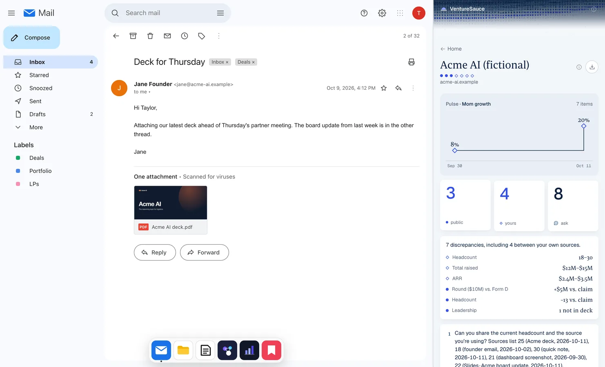
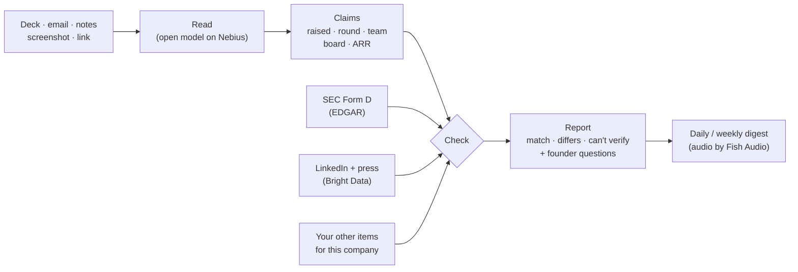
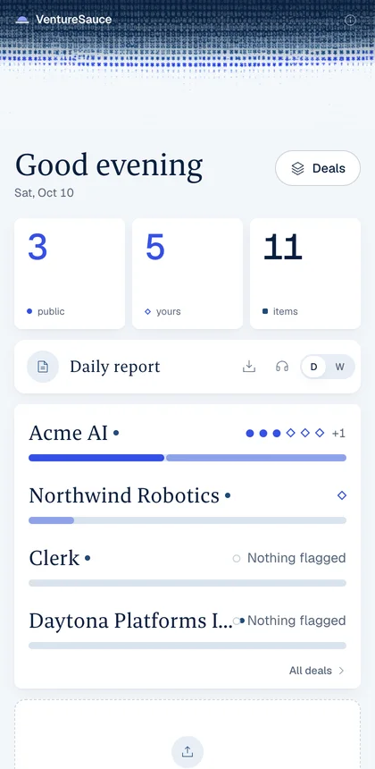
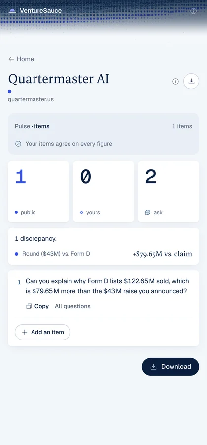

# VentureSauce

**Fact-check every founder claim before the partner meeting.**

Drop in a deck, an email, call notes or a screenshot. VentureSauce files it under the company, checks every claim against public records and against everything else the founder sent you, then hands you the questions to ask.



## Why

- Founders' numbers drift: $10M in the deck, $15M on the SEC filing, 30 people in the email, 18 on LinkedIn.
- Checking by hand means tabs, filings and spreadsheets for every deal.
- VentureSauce does it in the side panel, and **every number links to its source**.

## How it works



The model only **reads**. Every verdict comes from plain rules in code, so the same input always gives the same answer.

## What you get

<table>
<tr>
<td width="50%"></td>
<td width="50%"></td>
</tr>
<tr>
<td><b>Deal inbox.</b> Every company, what's flagged, a daily report.</td>
<td><b>Company report.</b> ● vs. public records &nbsp; ◇ vs. your own sources.</td>
</tr>
</table>

| Claim | Checked against |
| --- | --- |
| Money raised, round size | SEC Form D filings, funding press |
| Team size | LinkedIn (only the page the company's own site links to) |
| Board, executives | People listed on the Form D |
| ARR, growth, customers | Your other items: deck vs. email vs. notes |

## Try it

```bash
# backend (API + demo desk)
cd backend && cp .env.example .env     # add keys
uv sync --python 3.12 && uv run uvicorn main:app --port 8000

# panel
cd frontend && npm install && npm run dev   # http://localhost:3000/panel

# Chrome: chrome://extensions → Developer mode → Load unpacked → extension/
```

- **Demo desk:** `localhost:8000/demo`. Fake Gmail, Drive, Notes and CRM to drag items from.
- **Prefilled inbox:** `localhost:3000/panel?ws=demo`
- **No keys?** `VENTURESAUCE_FAKE=1` replays a sample run.

Acme AI and Northwind Robotics are fictional. Real companies (Daytona, Clerk, Legora) are checked only against their own public statements.

## Built with

**Nebius** (open model) · **Bright Data** (LinkedIn and press) · **Fish Audio** (spoken digest) · **SEC EDGAR** · FastAPI · Next.js · Chrome MV3

## More

[Demo script](docs/DEMO_SCRIPT.md) · [Backend and API](backend/README.md) · [Plan](docs/PLAN.md) · [Contributing (humans and agents)](AGENTS.md)
