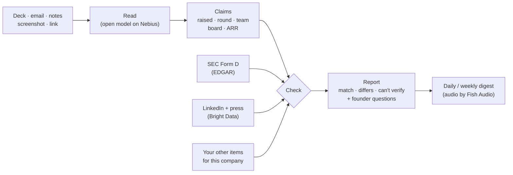
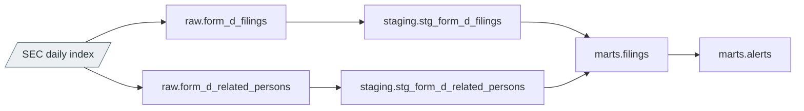
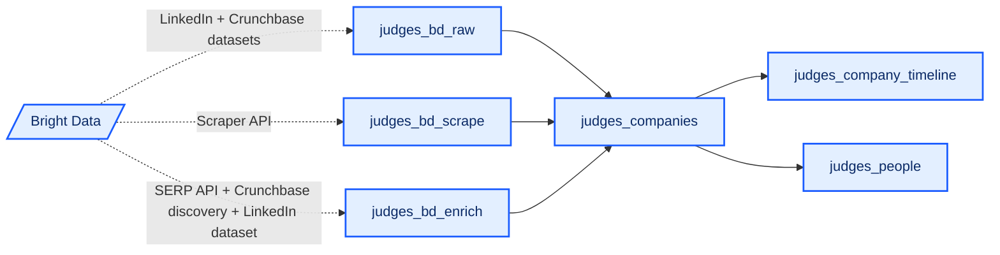

# VentureSauce

## Team 11 — Andi · Surya · Javier · Kevin

> [!NOTE]
> Huge thanks to [Bright Data](https://brightdata.com) for sponsoring the hackathon. Their SERP API, Scraper APIs and LinkedIn and Crunchbase datasets supply the company profiles, funding rounds and press coverage we check against SEC filings.

**Fact-check every founder claim before the partner meeting.**

Drop in a deck, an email, call notes or a screenshot. VentureSauce files it under the company, checks every claim against public records and against everything else the founder sent you, then hands you the questions to ask.


## Why

- Founders' numbers drift: $10M in the deck, $15M on the SEC filing, 30 people in the email, 18 on LinkedIn.
- Checking by hand means tabs, filings and spreadsheets for every deal.
- VentureSauce does it in the side panel, and **every number links to its source**.

## How it works



The model only **reads**. Every verdict comes from plain rules in code, so the same input always gives the same answer.

## What you get

<table>
<tr>
<td width="50%"></td>
<td width="50%"></td>
</tr>
<tr>
<td><b>Deal inbox.</b> Every company, what's flagged, a daily report.</td>
<td><b>Company report.</b> ● vs. public records &nbsp; ◇ vs. your own sources.</td>
</tr>
</table>

| Claim | Checked against |
| --- | --- |
| Money raised, round size | SEC Form D filings, funding press |
| Team size | LinkedIn (only the page the company's own site links to) |
| Board, executives | People listed on the Form D |
| ARR, growth, customers | Your other items: deck vs. email vs. notes |

## Try it

```bash
# backend (API + demo desk)
cd backend && cp .env.example .env     # add keys
uv sync --python 3.12 && uv run uvicorn main:app --port 8000

# panel
cd frontend && npm install && npm run dev   # http://localhost:3000/panel

# Chrome: chrome://extensions → Developer mode → Load unpacked → extension/
#         (for local, use the LOCAL line in extension/config.js)
```

- **Demo desk:** `localhost:8000/demo`. Fake Gmail, Drive, Notes and CRM to drag items from.
- **Prefilled inbox:** `localhost:3000/panel?ws=demo`
- **No keys?** `VENTURESAUCE_FAKE=1` replays a sample run.

Acme AI and Northwind Robotics are fictional. Real companies (Daytona, Clerk, Legora) are checked only against their own public statements.

## Data pipeline

[`pipeline/`](pipeline/) pulls every SEC Form D filing, builds a 1,000-startup deal-flow universe and enriches it with [Bright Data](https://brightdata.com) (Dagster, SQLMesh, DuckDB). See the [pipeline README](pipeline/README.md) for setup.

### How we use Bright Data

A Form D filing only tells you a company's name, city and how much it raised. Bright Data turns that into a full profile: who's behind it, how big it is, who invested and whether anyone has written about the round.

#### How the data flows

1. **SEC → [`startup_universe`](pipeline/sqlmesh/models/sec_edgar/startup_universe.sql)**: the 1,000 most recent young startups that raised at least $1M, from Form D.
2. **SERP API → [`bd_serp_funding`](pipeline/sqlmesh/models/sec_edgar/bd_serp_funding.py)**: searches Google for each startup's funding news and picks up its LinkedIn and Crunchbase URLs from the results.
3. **LinkedIn dataset + Scraper API → [`bd_linkedin_companies`](pipeline/sqlmesh/models/sec_edgar/bd_linkedin_companies.py)**: filters Bright Data's LinkedIn company dataset by name, then scrapes the pages the search found that the dataset doesn't have yet.
4. **Crunchbase dataset + Scraper API → [`bd_crunchbase_companies`](pipeline/sqlmesh/models/sec_edgar/bd_crunchbase_companies.py)**: does the same for Crunchbase, and also follows the Crunchbase links listed on LinkedIn pages.
5. **[`startup_companies_enriched`](pipeline/sqlmesh/models/sec_edgar/startup_companies_enriched.sql)**: scores every candidate profile against the SEC filing (HQ, founding year, LinkedIn ↔ Crunchbase cross-links) and keeps only confident matches. It flags `is_under_the_radar` when the SEC shows money raised but Bright Data finds no public trace of it.

#### Where each product is used

- **[SERP API](https://docs.brightdata.com/products/serp-api/introduction) (Google, parsed JSON)** in `bd_serp_funding`: funding headlines and profile URLs for every startup. Feeds `has_funding_press`, `press_headline_amount` and `is_under_the_radar` in `startup_companies_enriched`.
- **SERP API (Google News)** in `judges_bd_enrich`: dated funding headlines for the judges' companies. Feeds `judges_company_timeline`.
- **[LinkedIn company dataset](https://docs.brightdata.com/datasets/marketplace/filter-dataset-by-api) via the Dataset Filter API** in `bd_linkedin_companies` and `judges_bd_raw`: followers, headcount, HQ, founding year, last funding round and recent posts. Feeds the `li_*` columns in `startup_companies_enriched`, plus `judges_companies` and `judges_company_timeline`.
- **LinkedIn people dataset** in `judges_bd_raw` and `judges_bd_enrich`: judges, mentors and founders with their current company, experience and education. Feeds `judges_people`.
- **Crunchbase company dataset via the Dataset Filter API** in `bd_crunchbase_companies` and `judges_bd_raw`: funding rounds, lead investors, heat and growth scores and monthly visits. Feeds `cb_total_funding_usd` and `cb_lead_investors` in `startup_companies_enriched`, plus `judges_companies`.
- **[Scraper APIs](https://docs.brightdata.com/products/scrapers/linkedin/introduction) (LinkedIn, Crunchbase)** in `bd_linkedin_companies`, `bd_crunchbase_companies` and `judges_bd_scrape`: live pages for companies the datasets don't cover yet. Feeds the same tables as the datasets.
- **Crunchbase keyword discovery** in `judges_bd_enrich`: Crunchbase profiles found by keyword when no URL is known. Feeds `judges_companies`.

All calls go through [`src/delta/brightdata/client.py`](pipeline/src/delta/brightdata/client.py), which handles SERP rate-limit backoff, Dataset Filter and Scraper snapshots, and an on-disk cache so no record is paid for twice. The jobs that build each table are in [`src/delta/brightdata/enrich.py`](pipeline/src/delta/brightdata/enrich.py).

### Models

Every table in [`pipeline/`](pipeline/). **Blue marks everything powered by [Bright Data](https://brightdata.com)**: the API calls (labelled with the Bright Data product they use), the tables that fetch from them and the tables built on that data. Grey boxes are SEC sources and arrows show each model's main input.

#### Alerts

New Form D raises and amendments where the amount sold went up, from the daily EDGAR index.



#### Startup deal flow

The 1,000 most recent young startups from Form D, enriched through Bright Data with LinkedIn, Crunchbase and funding press. All tables live in the `sec_edgar` schema.

```mermaid
flowchart LR
  classDef source fill:#eceff1,stroke:#607d8b,color:#263238
  classDef brightdata fill:#e3efff,stroke:#1a5cff,stroke-width:2px,color:#0b2a66

  edgar_sets[/"SEC quarterly Form D data sets"/]:::source
  edgar_sets --> form_d_filings["form_d_filings"] --> startup_rounds["startup_rounds"] --> startup_companies["startup_companies"]
  edgar_sets --> form_d_related_persons["form_d_related_persons"] --> startup_people["startup_people"] --> startup_companies
  startup_companies --> startup_universe["startup_universe"]
  brightdata[/"Bright Data"/]:::brightdata
  startup_universe --> bd_serp_funding["bd_serp_funding"]:::brightdata
  bd_serp_funding --> bd_linkedin_companies["bd_linkedin_companies"]:::brightdata
  bd_linkedin_companies --> bd_crunchbase_companies["bd_crunchbase_companies"]:::brightdata
  bd_crunchbase_companies --> enriched["startup_companies_enriched"]:::brightdata
  brightdata -.->|SERP API| bd_serp_funding
  brightdata -.->|LinkedIn dataset + Scraper API| bd_linkedin_companies
  brightdata -.->|Crunchbase dataset + Scraper API| bd_crunchbase_companies
```



#### Hackathon judges

Curated companies behind the judges and mentors, built on Bright Data, with a trust score, an event timeline and the people linked to them. `judges_companies` and `judges_company_timeline` also join `form_d_filings` for SEC history.



## Built with

**Nebius** (open model) · **Bright Data** (LinkedIn and press) · **Fish Audio** (spoken digest) · **SEC EDGAR** · FastAPI · Next.js · Chrome MV3

## More

[Demo script](docs/DEMO_SCRIPT.md) · [Backend and API](backend/README.md) · [Data pipeline](pipeline/README.md) · [Plan](docs/PLAN.md) · [Contributing (humans and agents)](AGENTS.md)
