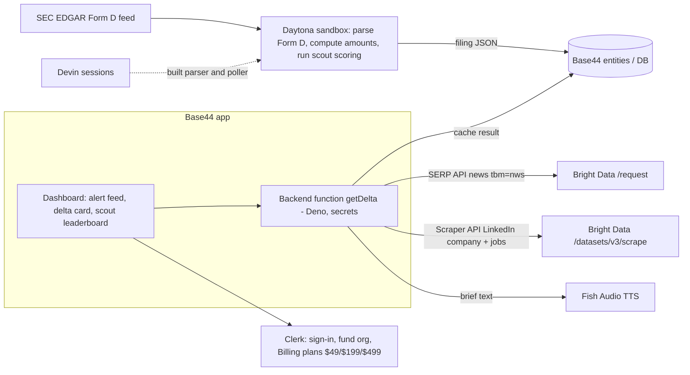

# Sponsor Integration Plan (VentureSauce, SenseAI Talk to Users, 2026-10-10)

Researched 2026-10-10. Legend: **[V]** verified in official docs this session, **[U]** unverified or from memory, check before building.

## TL;DR stack (6-hour build)

| Layer | Pick | Why |
|---|---|---|
| Live-web data (GRAND PRIZE) | **Bright Data**: Scraper API sync `/datasets/v3/scrape` (LinkedIn company, jobs) + SERP API news `tbm=nws` + Web Unlocker for the SEC/press-release page | One REST host, one API key, three calls give the "delta" |
| Frontend (track prize) | **Base44** Builder plan app + backend functions (Deno) that call Bright Data and our API | Required for the $750 Base44 track |
| Auth + tiers | **Clerk** (Organizations for funds, Clerk Billing for $49/$199/$499) | Pitch headline example, sponsor |
| Payments | Clerk Billing runs on Stripe; use plain Stripe Checkout only if Base44 auth is used | Avoid wiring two billing systems |
| Storage | **MongoDB Atlas** (filings, alerts, cached BD results) | Optional; Base44's built-in DB is enough if time runs short |
| Voice | **Fish Audio** TTS for a 30-second spoken morning brief | Cheap demo wow |
| Sandboxes | **Daytona** to run the Form D parser + delta job | Pitch headline example, sponsor |
| Coding help | **Devin** to build side tasks in parallel | Cognition prize needs a Devin-built artifact |

---

## 1. Bright Data (Grand Prize, $750, must use)

Docs index (LLM-friendly): https://docs.brightdata.com/llms.txt **[V]**. Auth everywhere: `Authorization: Bearer <API_KEY>` **[V]**.

### Product fit

| Product | Use in VentureSauce | Fit |
|---|---|---|
| **Web Scraper API** (pre-built, 1,200+ scrapers) | Structured company profile + hiring data from LinkedIn (company, jobs). Sync `POST https://api.brightdata.com/datasets/v3/scrape?dataset_id=...&format=json`, up to 20 URLs, 1-minute timeout then returns 202 + `snapshot_id` **[V]** https://docs.brightdata.com/api-reference/scrapers/synchronous-requests | Best |
| **SERP API** | "Was this round announced?" via Google News search. `POST https://api.brightdata.com/request` with `{zone, url:"https://www.google.com/search?q=...&tbm=nws&brd_json=1", format:"raw"}` **[V]** https://docs.brightdata.com/api-reference/serp/google-search/news | Best |
| **Web Unlocker** | Fetch any press/blog page or the company's own news page when no pre-built scraper exists; same `/request` endpoint with an unlocker zone (`agent_unlocker` zone is pre-created for new accounts) **[V]** (llms.txt) | Good fallback |
| **MCP server** | Hosted `https://mcp.brightdata.com/mcp?token=...`; 75 tools incl. `search_engine`, `scrape_as_markdown`, structured `web_data_*` tools; free tier 5,000 requests/month **[V]** https://github.com/brightdata/brightdata-mcp. Great for the Devin/Claude agent that writes the delta summary and for a judge demo ("agent has Bright Data tools") | Good, optional |
| **Scraping Browser (Browser API)** | Only if a target needs clicks/login. Skip. | Overkill |
| **Datasets Marketplace** | Pre-collected Crunchbase/LinkedIn snapshots for backfill or demo seeds: https://docs.brightdata.com/api-reference/marketplace-dataset-api/overview **[V]** (page exists; not read in depth) | Optional |
| **Python SDK** | `pip install brightdata-sdk`; `client.scrape.linkedin.profiles(url=...)`; pass `auto_create_zones=False` if only using Scraper API **[V]** | Handy if backend is Python |

Known dataset IDs **[V]** (https://docs.brightdata.com/datasets/scrapers/linkedin/send-first-request):
- LinkedIn Companies `gd_l1vikfnt1wgvvqz95w` (input `{"url":"https://www.linkedin.com/company/<slug>"}`)
- LinkedIn Jobs `gd_lpfll7v5hcqtkxl6l`
- LinkedIn Profiles `gd_l1viktl72bvl7bjuj0`, Posts `gd_lyy3tktm25m4avu764`

Crunchbase and Glassdoor dataset IDs: **[U]**. Do not guess; look them up (no key needed): https://docs.brightdata.com/scrapers.json then https://docs.brightdata.com/scrapers/{dataset_id}.json for input fields. Note Crunchbase pages are paywalled for funding detail, so treat Crunchbase as a "does the aggregator list this round yet" check, not a ground-truth source. LinkedIn company output includes `employees_in_linkedin`, `followers`, `crunchbase_url`, `website`, `founded` **[V]**.

### Exact calls for the demo (build these three, nothing else)

**Call 1: "Announced or not?" (SERP API, news)** , the headline.
```
POST https://api.brightdata.com/request
{ "zone": "<serp_zone>",
  "url": "https://www.google.com/search?q=%22Acme+Inc%22+raises+OR+funding+OR+%22Series+A%22&tbm=nws&tbs=qdr:m&brd_json=1",
  "format": "raw" }
```
`tbm=nws` = news **[V]**; `brd_json=1` = parsed JSON **[V]** (https://docs.brightdata.com/products/serp-api/query-parameters/google). Response has `news[]` with `title, link, source, date` **[V]**. Logic: zero hits within the filing-to-today window means "filed, not announced"; any hit gives the first press date, so `days_between(filing_date, first_press_date)` is our "104 days" style stat. `tbs=qdr:m` (past month) date restriction is **[U]**, test it; fallback is filtering `date` client-side.

**Call 2: "Live company snapshot" (Scraper API sync, LinkedIn company)**
```
POST https://api.brightdata.com/datasets/v3/scrape?dataset_id=gd_l1vikfnt1wgvvqz95w&format=json
[ {"url":"https://www.linkedin.com/company/<slug>"} ]
```
Gives headcount, followers, website, Crunchbase URL. Delta: filing says "$X raised, hiring plans unknown" versus live headcount and recruiting. To find the slug, use Call 1 style SERP query `site:linkedin.com/company "Acme"` (the same SERP endpoint, no `tbm`).

**Call 3 (optional third): "Hiring signal" (Scraper API, LinkedIn Jobs, `gd_lpfll7v5hcqtkxl6l`)** or **Web Unlocker** on the company site `/press` or `/news` page for a first-party announcement. Pick Jobs: hiring surge right after a filing is a strong "round closed" signal for the pitch.

**Delta report shape:** `{filing: {amount_sold, amount_unsold, date, issuer}, live: {announced: bool, first_press_url, first_press_date, headcount, open_roles}, delta: {days_unannounced, headcount_vs_filing_claims}}`, with every field linking to its source (our "cited both sides" promise).

Cost/limits: free MCP tier 5,000 req/month **[V]**; Scraper API and SERP pricing **[U]**, hacker-pack credits are in the Sense Check Guide PDF (do not push that PDF). Cache every result in the DB so the live demo never depends on a 60-second scrape; pre-warm the 3 demo companies (Clerk, Daytona, one more).

---

## 2. Base44 (Track Prize, $750, must use)

- **What:** AI no-code/vibe-coding app builder (frontend + backend + DB + auth). Founded 2025, owned by Wix **[V]** (Ore Segal's LinkedIn). https://base44.com
- **Plans:** Builder is $40/mo (monthly list; 250 message credits and 10,000 integration credits per month; includes backend functions, GitHub integration, code edits) **[V]** https://base44.com/pricing, https://docs.base44.com/Account-and-billing/Billing-and-plans. Check whether hacker-pack promo gives Builder; **backend functions and connectors need Builder or higher** **[V]** https://docs.base44.com/Integrations/Using-integrations.
- **External APIs: yes.**
  - *Backend functions* run on **Deno/TypeScript**, call from the frontend via the SDK, each gets its own HTTP endpoint (usable as a webhook), can be scheduled, and keep keys in per-app **Secrets** **[V]** https://docs.base44.com/developers/backend/resources/backend-functions/overview.
  - *Custom OpenAPI integrations* (workspace-level) call via `base44.integrations.custom.call()` with credentials not exposed to the browser **[V]**.
  - *MCP connections* (Builder+) let Base44's AI chat call MCP servers, so Bright Data's hosted MCP could be attached **[V]**, behaviour **[U]**.
  - Each app can also expose an *app MCP server* **[V]**.
- **How to use it (recommended):** Build the whole dashboard in Base44: alert feed, filing-vs-live "delta card", watchlist, scout leaderboard. Put the Bright Data calls in **one Base44 backend function** `getDelta(cik|company)` that reads the key from Secrets, runs Calls 1-3, and stores the result in a Base44 entity (cached). Frontend only calls `getDelta`. This visibly satisfies "built on Base44" and "uses Bright Data" in one architecture box. Keep EDGAR polling outside Base44 (Daytona job or a Base44 scheduled function) if the hackathon allows, writing to the same entities via the Base44 SDK / HTTP endpoint **[U]** for external writes.
- **Risk:** Base44 backend is beta **[V]**; do a hello-world function call to Bright Data in the first 30 minutes. Fallback: call Bright Data directly from a small Node/Python service and have Base44 call it over HTTP.

---

## 3. Other sponsors

### Cognition / Devin ($500)
- Devin API v3: `POST https://api.devin.ai/v3/organizations/{org_id}/sessions` with `{"prompt": ..., "structured_output_schema": ...}`, bearer token prefix `cog_` **[V]** https://docs.devin.ai/api-reference/v3/sessions/post-organizations-sessions. Poll or open `https://app.devin.ai/sessions/<id>`.
- Use: hand Devin 2-3 independent, well-specified chores (Form D XML parser with tests, EDGAR daily-index poller, seed-data script) so the repo shows Devin-authored commits. Cheap, parallel, easy to demo ("Devin built the parser"). Judging criteria for the Cognition prize **[U]**, ask a mentor. Do not make Devin a runtime dependency.

### Daytona ($250)
- Sandboxes for running untrusted/AI-generated code, SDKs for Python and TypeScript, API + CLI; sub-90ms spin-up claimed **[V]** https://www.daytona.io/docs/llms.txt. API keys per https://www.daytona.io/docs/en/api-keys.md.
- Use: run the **Form D parse + delta job inside a Daytona sandbox** (each alert = one ephemeral sandbox; shows the "scouts' claims scored against filings" scoring is reproducible and isolated). Minimal SDK usage (`@daytonaio/sdk`, `daytona.create()`, `sandbox.process.codeRun(...)`, `sandbox.delete()`) is **[U]**, confirm against docs. Pitch bonus: our headline example is a Daytona filing, so name-drop it to the Daytona judge/mentors, but only with verified numbers (see `Market Research/claims-verification.md`).

### Clerk ($250)
- **Organizations** for funds (members, roles) **[V]**; **Clerk Billing**: plans and features defined in Clerk Dashboard, per-seat B2B billing, entitlements on the session token checked with `has()`, `<PricingTable />`-style component, 0.7% on top of Stripe fees, Stripe only processes payments, plans not synced to Stripe, enable with `npx clerk@latest enable billing --for orgs` **[V]** https://clerk.com/docs/guides/billing/overview, https://clerk.com/articles/authentication-billing-how-clerk-and-stripe-work-together.md.
- Use: sign-in plus fund org, three plans ($49 Alerts, $199 Delta reports, $499 Scout network) gating features with `has({feature})`. Dev instance uses a Stripe test account automatically **[V]**, so the demo needs no real payment setup.
- **Caveat:** Base44 has its own built-in auth. Using Clerk inside a Base44 app is **[U]** (possible via custom frontend code/JWT; unconfirmed). If it fights you after 30 minutes, keep Base44 auth for the app and show Clerk only on a separate gated "fund workspace" page, or drop Clerk.

### Stripe
- Checkout Session in `mode: 'subscription'`, three Prices ($49/$199/$499 recurring), webhook `customer.subscription.created/updated` to flip entitlements, Customer Portal for management **[V]** (pattern shown at https://clerk.com/blog/per-user-licensing-with-stripe-and-clerk-organizations). Use test mode and test cards. If Clerk Billing is used, skip direct Stripe code entirely. If Base44 is the auth layer, use Base44's Stripe integration or a backend function creating the Checkout Session **[U]**.
- Docs: https://docs.stripe.com/billing/subscriptions/build-subscriptions

### MongoDB Atlas
- Store `filings`, `deltas`, `alerts`, `scout_calls`. Atlas Vector Search (`$vectorSearch`) / Atlas Search could power "find similar rounds" or fuzzy issuer-name matching between EDGAR names and press names (a real pain: "Acme Holdings LLC" vs "Acme") **[U]** syntax, https://www.mongodb.com/docs/atlas/atlas-vector-search/. The MongoDB MCP server failed to connect in this session (not needed for this research).
- Recommendation: use Atlas **Search (text/fuzzy) for entity matching** only if time permits. Otherwise Base44's built-in DB is enough. Do not add Mongo just to say you did; it adds a second data store and a network hop.

### Fish Audio
- REST TTS (`POST https://api.fish.audio/v1/tts`, bearer key) plus WebSocket streaming; Python and JS SDKs **[V]** endpoints list at https://docs.fish.audio/llms.txt, https://docs.fish.audio/api-reference/endpoint/openapi-v1/text-to-speech.md. Request body fields (`text`, `reference_id`, `format`) and the model header **[U]**, read the page.
- Use: "Play today's brief" button that speaks 3 alerts ("Daytona filed a Form D 6 days before announcing..."). 20-minute build, high demo value. Cut first if behind.

### SenseAI / Sense Checks
- Sense Checks are 3 per team, testers are finance pros, results in about an hour (see `Hackathon Context/hackathon-brief.md`). The "integration" is process: Block 1 tests the idea, Block 2 shows the real Base44 build, Block 3 asks our own question. **Judging rewards the tester quote that changed the build**, so keep the dashboard changeable (Base44 edits fast) and log each quote in `Sense Check Log/`.

---

## 4. Judges and mentors (from public profiles; no more than what sources say)

- **Ore Segal (Base44), judge and 10:00 talk.** Venture Development Lead at Base44 since Jan 2026, runs the Base44 Accelerator (first student vibe-coding accelerator; 44 teams, demo day July 2026 in NYC). Previously Venture Partner at VU Venture Partners (a VC), Tailor Brands UX researcher; Reichman University Psychology and Neuroscience student, co-founded MindMuscle **[V]** LinkedIn https://linkedin.com/in/oresegal, https://www.linkedin.com/posts/oresegal_thrilled-to-be-leading-base44s-accelerator-activity-7442918340005810176-hCbs. Likely values: a real app actually built on Base44 (not a mock), founder-to-company potential, practical VC/deal-flow insight (he is ex-sourcing, so he knows the Form D pain), fast iteration and user feedback. Show a **live Base44 app**, mention it as the build tool, demo the editing speed.
- **Kieran (Athena), judge and mentor.** Most likely Kieran John Keenan, Co-founder and CTO of Athena ("agent-native law firm"), formerly Member of Technical Staff at Legora (eval infrastructure and AI agents), founder of Nemoest (legal reasoning with LLMs, custom evals), Athena in a16z Speedrun cohort **[V; identity match is U]** https://www.linkedin.com/in/kieran-john-keenan, https://www.linkedin.com/posts/valeriewhitten_our-next-founder-mentor-is-here-kieran-john-activity-7507971249890058240-OYCK. Likely values: trustworthy AI outputs, evals, citations ("every claim links to the filing"), agent workflows with verification. Lean into the "scouts are scored against filings" and "both sides cited" angle; show the verification logic, not just the UI. (A different "Athena AI" life-advisor company also exists; do not confuse them.)
- **DongYeop Lee (Sense AI), judge.** No reliable public profile found in this search (results returned unrelated "sense.ai" firms). **[U]** Assume he cares most about the hackathon's stated criteria: real user pain in users' own words, the hidden problem surfaced by asking users, what changed after Sense Checks, and works live. Ask him or an organizer.
- **Anna (judge):** no information given; **[U]**.
- Mentors (Anthea/Lumeria, Nick/MochaCare, Abel/Oasiz, Gal and Omri/Dial, Ana Yoon/Pavoot, Alspencer/PreMan) not researched; use mentor slots (11-12, 2-3, 5-6) to get each sponsor's integration questions answered and to hear what judges care about.

---

## 5. Prize stacking

| Prize | Winnable together? | Effort to qualify | Verdict |
|---|---|---|---|
| Bright Data Grand ($750) | Yes, it is the core data engine | Medium | **Primary target** |
| Base44 Track ($750) | Yes, the app *is* Base44 | Medium (platform quirks) | **Primary target** |
| Clerk ($250) | Yes if Clerk auth/billing works in the stack | Low if standalone page; unknown inside Base44 | Go for it, but cap at 45 min |
| Daytona ($250) | Yes, one sandboxed job | Low | Go for it (30 min) |
| Cognition ($500) | Yes, Devin builds side modules | Low to run; judging criteria unknown | Try, low runtime risk; do not depend on it |
| Fish/Mongo/Stripe | Supporting; no prize amount listed | Low-medium | Fish only (cheap wow); Mongo/Stripe only if free |

Realistic: Bright Data + Base44 as the two headline wins (both are directly in the product story), then Clerk/Daytona/Cognition as cheap add-ons. Winning general judging (Sense AI) depends on the Sense Check quotes more than on sponsor count, so protect time for Blocks 2 and 3 (3-4 PM, 6-7 PM). Do **not** try to integrate all eight.

### Architecture (minimal)



Optional (only if ahead): Mongo Atlas instead of Base44 DB for entity-name fuzzy matching.

### Time-boxed plan (about 6 hours)
1. 0:00-0:45 Bright Data key; run Call 1 and Call 2 from curl for Clerk and Daytona; save JSON as fixtures. Base44 hello-world backend function hitting the same URLs. Kick off Devin sessions (parser, poller).
2. 0:45-2:15 Base44 dashboard + `getDelta` + cached demo companies; first Sense Check (12-1) uses the pitch only.
3. 2:15-3:30 Daytona sandbox job; Clerk sign-in and plan gating (45-minute cap).
4. 3:30 Show Base44 build in Sense Check 2 (3-4 PM); change one thing from the quote.
5. Evening: Fish brief button, polish, record fallback demo video, submit before 8:00 PM.

## Open items to resolve quickly
- Crunchbase and Glassdoor dataset IDs, exact SERP and Scraper API pricing, hacker-pack credit amounts (ask Bright Data booth).
- Clerk inside Base44 feasibility; Base44 Builder plan via hacker pack.
- Daytona SDK snippet and Fish TTS request body (read the linked pages).
- Cognition and Daytona prize judging criteria.
