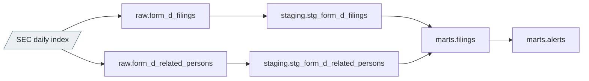
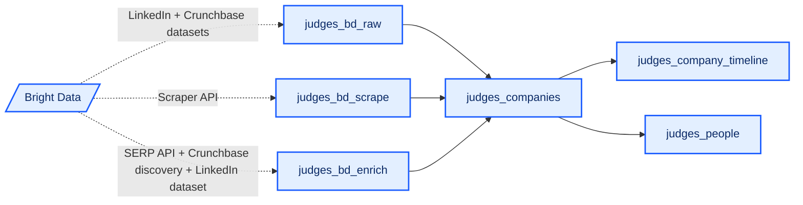

# delta

Every private raise filed with the SEC (Form D), modeled into an alert feed and a VC deal-flow table enriched with [Bright Data](https://brightdata.com) (LinkedIn, Crunchbase, Google).

## Thanks to Bright Data

Thank you to [Bright Data](https://brightdata.com) for sponsoring the hackathon. Every `bd_*` and `judges_bd_*` table runs on their products: the [SERP API](https://docs.brightdata.com/products/serp-api/introduction) for funding-press search, the [Marketplace Dataset Filter API](https://docs.brightdata.com/datasets/marketplace/filter-dataset-by-api) for LinkedIn and Crunchbase company and people profiles, and the [Scraper APIs](https://docs.brightdata.com/products/scrapers/linkedin/introduction) for pages the datasets don't cover yet.

## Alerts (daily EDGAR index)

- **`raw.form_d_filings`**: Form D and D/A filings as filed
- **`raw.form_d_related_persons`**: Directors, executives and promoters on each filing
- **`staging.stg_form_d_filings`**: Typed filings, one row per accession
- **`staging.stg_form_d_related_persons`**: Typed people and roles
- **`marts.filings`**: Filings with sector, sell-through and change in amount sold
- **`marts.alerts`**: New raises and amendments where the amount sold went up

## Startup deal flow (`sec_edgar`)

- **`form_d_filings`** (Python): One row per Form D filing from the SEC quarterly Form D data sets (2025Q1 onward)
- **`form_d_related_persons`** (Python): Officers, directors and promoters on each filing
- **`startup_rounds`** (SQL): One row per offering by an operating corporation, amendments collapsed
- **`startup_people`** (SQL): One row per (startup, person) with CEO / founder / CTO and repeat-insider flags
- **`startup_companies`** (SQL): One row per issuer: funding totals, latest round, leadership, VC signal score
- **`startup_universe`** (SQL): The tracked set: young tech / bio / energy corporations with at least $1M raised
- **`bd_serp_funding`** (Python · Bright Data): SERP API funding-press and profile-URL search per universe company
- **`bd_linkedin_companies`** (Python · Bright Data): LinkedIn company candidates (Dataset Filter, then Scraper API for SERP-found pages)
- **`bd_crunchbase_companies`** (Python · Bright Data): Crunchbase candidates (Dataset Filter, then Scraper API for SERP / LinkedIn URLs)
- **`startup_companies_enriched`** (SQL · Bright Data): The deal-flow table: universe plus the best validated LinkedIn and Crunchbase match and funding press
- **`judges_bd_raw`** (Python · Bright Data): Dataset Filter records for the hackathon judges, mentors, their companies and proxies
- **`judges_bd_scrape`** (Python · Bright Data): Scraper API gap fill for pages the datasets missed
- **`judges_bd_enrich`** (Python · Bright Data): Crunchbase keyword discovery, Google News funding headlines, founder profiles
- **`judges_companies`** (SQL · Bright Data): Curated judges / mentors companies with LinkedIn, Crunchbase and SEC data and a trust score
- **`judges_company_timeline`** (SQL · Bright Data): Form D filings, LinkedIn posts and funding headlines per curated company
- **`judges_people`** (SQL · Bright Data): Founders, judges and mentors linked to the curated companies

Every Bright Data and SEC response is cached under `data/cache`, so re-runs only pay for companies not fetched before. Without `BRIGHT_DATA_API_KEY` the paid models read the cache only and make no requests. `BRIGHT_DATA_MAX_COMPANIES` caps how many universe companies are enriched and `UNIVERSE_SIZE` sets the universe size.

Stack: Dagster, SQLMesh, DuckDB locally or MotherDuck when `MOTHERDUCK_TOKEN` is set.

```sh
uv sync
cp .env.example .env
uv run dagster dev
(cd sqlmesh && uv run sqlmesh plan --auto-apply)
uv run pytest && (cd sqlmesh && uv run sqlmesh test)
```

## How we use Bright Data

A Form D filing only tells you a company's name, city and how much it raised. Bright Data turns that into a full profile: who's behind it, how big it is, who invested and whether anyone has written about the round.

### How the data flows

1. **SEC → [`startup_universe`](sqlmesh/models/sec_edgar/startup_universe.sql)**: the 1,000 most recent young startups that raised at least $1M, from Form D.
2. **SERP API → [`bd_serp_funding`](sqlmesh/models/sec_edgar/bd_serp_funding.py)**: searches Google for each startup's funding news and picks up its LinkedIn and Crunchbase URLs from the results.
3. **LinkedIn dataset + Scraper API → [`bd_linkedin_companies`](sqlmesh/models/sec_edgar/bd_linkedin_companies.py)**: filters Bright Data's LinkedIn company dataset by name, then scrapes the pages the search found that the dataset doesn't have yet.
4. **Crunchbase dataset + Scraper API → [`bd_crunchbase_companies`](sqlmesh/models/sec_edgar/bd_crunchbase_companies.py)**: does the same for Crunchbase, and also follows the Crunchbase links listed on LinkedIn pages.
5. **[`startup_companies_enriched`](sqlmesh/models/sec_edgar/startup_companies_enriched.sql)**: scores every candidate profile against the SEC filing (HQ, founding year, LinkedIn ↔ Crunchbase cross-links) and keeps only confident matches. It flags `is_under_the_radar` when the SEC shows money raised but Bright Data finds no public trace of it.

### Where each product is used

- **[SERP API](https://docs.brightdata.com/products/serp-api/introduction) (Google, parsed JSON)** in `bd_serp_funding`: funding headlines and profile URLs for every startup. Feeds `has_funding_press`, `press_headline_amount` and `is_under_the_radar` in `startup_companies_enriched`.
- **SERP API (Google News)** in `judges_bd_enrich`: dated funding headlines for the judges' companies. Feeds `judges_company_timeline`.
- **[LinkedIn company dataset](https://docs.brightdata.com/datasets/marketplace/filter-dataset-by-api) via the Dataset Filter API** in `bd_linkedin_companies` and `judges_bd_raw`: followers, headcount, HQ, founding year, last funding round and recent posts. Feeds the `li_*` columns in `startup_companies_enriched`, plus `judges_companies` and `judges_company_timeline`.
- **LinkedIn people dataset** in `judges_bd_raw` and `judges_bd_enrich`: judges, mentors and founders with their current company, experience and education. Feeds `judges_people`.
- **Crunchbase company dataset via the Dataset Filter API** in `bd_crunchbase_companies` and `judges_bd_raw`: funding rounds, lead investors, heat and growth scores and monthly visits. Feeds `cb_total_funding_usd` and `cb_lead_investors` in `startup_companies_enriched`, plus `judges_companies`.
- **[Scraper APIs](https://docs.brightdata.com/products/scrapers/linkedin/introduction) (LinkedIn, Crunchbase)** in `bd_linkedin_companies`, `bd_crunchbase_companies` and `judges_bd_scrape`: live pages for companies the datasets don't cover yet. Feeds the same tables as the datasets.
- **Crunchbase keyword discovery** in `judges_bd_enrich`: Crunchbase profiles found by keyword when no URL is known. Feeds `judges_companies`.

All calls go through [`src/delta/brightdata/client.py`](src/delta/brightdata/client.py), which handles SERP rate-limit backoff, Dataset Filter and Scraper snapshots, and an on-disk cache so no record is paid for twice. The jobs that build each table are in [`src/delta/brightdata/enrich.py`](src/delta/brightdata/enrich.py).

## Models

Every table in [`pipeline/`](). **Blue marks everything powered by [Bright Data](https://brightdata.com)**: the API calls (labelled with the Bright Data product they use), the tables that fetch from them and the tables built on that data. Grey boxes are SEC sources and arrows show each model's main input.

### Alerts

New Form D raises and amendments where the amount sold went up, from the daily EDGAR index.



### Startup deal flow

The 1,000 most recent young startups from Form D, enriched through Bright Data with LinkedIn, Crunchbase and funding press. All tables live in the `sec_edgar` schema.

```mermaid
flowchart LR
  classDef source fill:#eceff1,stroke:#607d8b,color:#263238
  classDef brightdata fill:#e3efff,stroke:#1a5cff,stroke-width:2px,color:#0b2a66

  edgar_sets[/"SEC quarterly Form D data sets"/]:::source
  edgar_sets --> form_d_filings["form_d_filings"] --> startup_rounds["startup_rounds"] --> startup_companies["startup_companies"]
  edgar_sets --> form_d_related_persons["form_d_related_persons"] --> startup_people["startup_people"] --> startup_companies
  startup_companies --> startup_universe["startup_universe"]
  brightdata[/"Bright Data"/]:::brightdata
  startup_universe --> bd_serp_funding["bd_serp_funding"]:::brightdata
  bd_serp_funding --> bd_linkedin_companies["bd_linkedin_companies"]:::brightdata
  bd_linkedin_companies --> bd_crunchbase_companies["bd_crunchbase_companies"]:::brightdata
  bd_crunchbase_companies --> enriched["startup_companies_enriched"]:::brightdata
  brightdata -.->|SERP API| bd_serp_funding
  brightdata -.->|LinkedIn dataset + Scraper API| bd_linkedin_companies
  brightdata -.->|Crunchbase dataset + Scraper API| bd_crunchbase_companies
```



### Hackathon judges

Curated companies behind the judges and mentors, built on Bright Data, with a trust score, an event timeline and the people linked to them. `judges_companies` and `judges_company_timeline` also join `form_d_filings` for SEC history.


